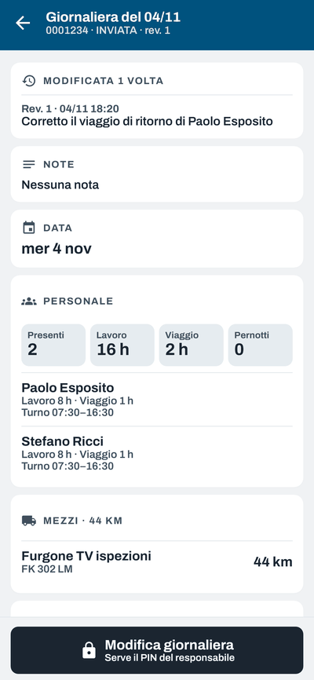
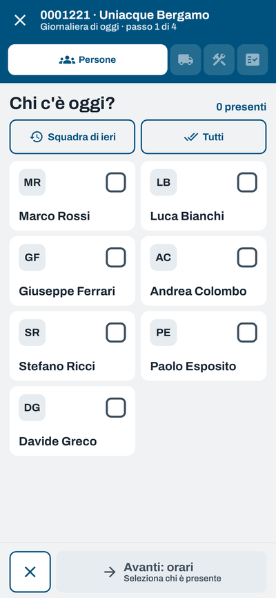
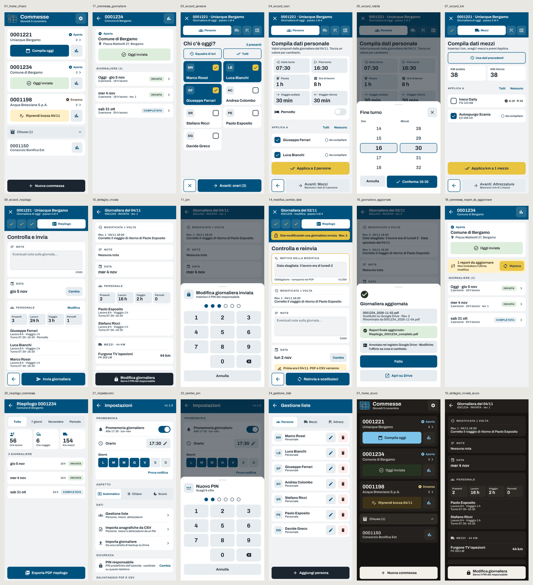

# Redesign "Prototipo 3d" e modifica delle giornaliere

 



## Cosa cambia per chi usa l'app

- **Nuova grafica**: font Archivo, pulsanti grandi (si usano coi guanti), tema chiaro/scuro/automatico.
- **Home**: ogni commessa ha un solo pulsante principale (*Compila oggi*, *Riprendi bozza*, *Oggi inviata*).
- **Compilazione**: persone → orari con «Applica a», mezzi → km, attrezzature, riepilogo. Le regole restano quelle di prima (almeno una persona e almeno un mezzo).
- **Modifica di una giornaliera inviata**: lucchetto → PIN del responsabile (predefinito **202900**, si cambia in Impostazioni › Sicurezza) → motivo obbligatorio → *Reinvia e sostituisci*.
- **File sostituiti, non duplicati**: PDF e CSV su Drive (o nella cartella del telefono) vengono sovrascritti. Se cambia la data, lo stesso file viene rinominato. Su Drive la versione precedente resta nella cronologia delle versioni.
- **Report finale aggiornato da solo**: i report esportati da quel telefono che contengono la data (vecchia o nuova) vengono rigenerati. Anche l'export a mano ora sovrascrive invece di creare un doppione.
- **Registro per l'ufficio**: cartella `Modifiche/`, un CSV per ogni modifica.
- **Eliminare** una persona, un mezzo o un'attrezzatura non la toglie più dalle giornaliere già compilate (prima la cancellazione a cascata la rimuoveva anche dal passato).

## Rilascio sicuro (una sola volta)

1. Prima di aggiornare: inviare le bozze sui telefoni.
2. Compilare l'APK in Android Studio **con la stessa chiave di firma di sempre**.
3. Installare su **un solo telefono** di prova. Se Android chiede di disinstallare la versione vecchia: **fermarsi** (disinstallare cancella i dati).
4. Provare: aprire una giornaliera vecchia, modificarla con il PIN, controllare su Drive che ci sia un solo file.
5. Dopo qualche giorno, aggiornare gli altri telefoni.

La migrazione del database (v6 → v7) aggiunge solo colonne e tabelle: nessun dato viene toccato. È verificata da `MigrationTest`.

## Test e screenshot

```bash
./gradlew :app:testDebugUnitTest
```

- 57 test: migrazione del database, sostituzione file (7 casi: ID noto, ricerca per nome, file sparito, altro account, rete giù…), nomi file, PIN e blocco, regole del wizard, flusso completo del ViewModel con database vero (compilazione, modifica con PIN, cambio data, reinvio, annulla).
- Gli screenshot (Robolectric + Roborazzi) finiscono in `app/build/screenshots/`, i fotogrammi delle GIF in `app/build/screenshots/gif/`.

## Da provare su un telefono vero

Non verificabili qui (servono account Google e dispositivo reale):

- sostituzione e rinomina su Google Drive con un account vero;
- rinomina e sovrascrittura nella cartella del telefono (SAF) con il proprio file manager;
- piè di pagina "Rev. N" nel PDF;
- condivisione (WhatsApp/email) in modalità *Condividi*.
